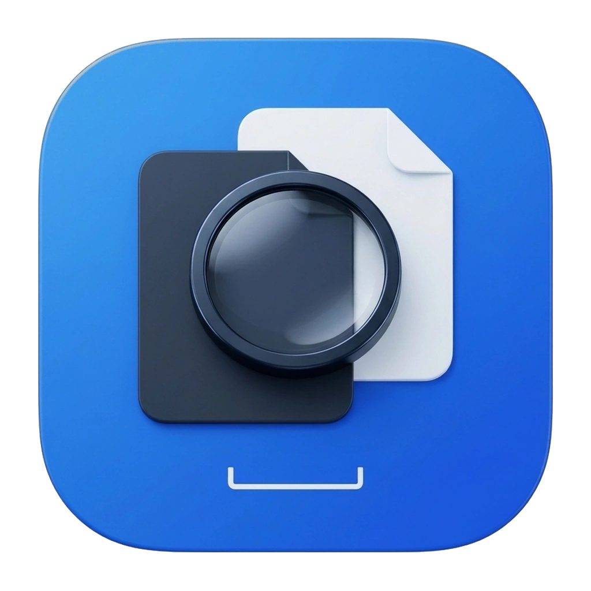

<div align="center">



# Space Previewer

**Quick Look spacebar file previewer for GNOME / Nautilus — fast, resizable, Libadwaita-native.**

[](LICENSE)
[](#tested-environments)
[](#features)
[](VERSION)

</div>

---

## Why Space Previewer vs `gnome-sushi`

| Capability | Default `gnome-sushi` | Space Previewer |
|---|---|---|
| **Markdown (`.md`, `.mdx`)** | Raw plain-text source only | Rendered GFM preview (tables, task lists, callouts), offline Cairo Mermaid diagrams, Raw/Preview toggle |
| **In-file search (`Ctrl+F`)** | Not supported | Non-grabbing overlay search in code, plain text, and rendered Markdown (`Enter` / `Shift+Enter`) |
| **Line & block quote copy** | Not supported | Drag line numbers in code/text or click rendered Markdown blocks (`Shift+Click` for range) to copy text or `path:start-end` reference |
| **CSV / TSV** | Plain text | Formatted scrollable table grid with column headers |
| **Archives (`.zip`, `.tar.*`)** | Summary size only | Full file tree listing with entry sizes without extracting to disk |
| **Office (`.docx`, `.xlsx`, `.pptx`)** | Requires full LibreOffice stack | Zero-dependency direct ZIP/XML text & sheet extraction with strict input bounds |
| **Folders** | Item count only | Item counts, preview of the first entries, and non-blocking background total size scan |
| **PDF Documents** | Single-page view | Continuous fit-width viewport with lazy page rasterisation and smooth `PageUp`/`PageDown` navigation |

---

## Features

- **Instant Spacebar Preview**: Press `Space` on any file or folder in Nautilus to peek into its content.
- **Auto-Update on Navigation**: Keep the preview window open and use the arrow keys `Up` `Down` `Left` `Right` in Nautilus to browse through files.
- **Stacked with Files**: Attaches as a transient child of the active Nautilus window on both Wayland and X11, stacking cleanly under the Files icon in the GNOME Dock.
- **Copy a line range**: Text and code are selectable; drag the line numbers to pick whole lines, or click a rendered Markdown block (`Shift+Click` to extend). Copy the range as plain text, or copy a `path:start-end` reference (`Ctrl+Shift+C`).
- **One chrome for every viewer**: A single `Adw.HeaderBar` and one bottom status bar. File type, size and metadata live in the status bar; viewers never add their own toolbar row.
- **Images**: PNG, JPG, WebP, GIF (animated), SVG, BMP; `Ctrl+Scroll` zooms.
- **Code & Text**: Syntax-highlighted preview for Python, JS, TS, HTML, CSS, JSON, YAML, Shell, SQL, Markdown, and plain text, with in-file search and JSON pretty-printing.
- **Markdown**: Rendered preview with GFM tables, task lists, callouts, Mermaid diagrams (local Cairo renderer; remote `mermaid.ink` opt-in) and a raw source toggle.
- **HTML**: Local pages rendered with WebKitGTK 6.0 when installed; remote content is blocked by default via CSP and the page falls back to source view without WebKit.
- **CSV / TSV**: Formatted table grid view with column headers.
- **PDF Documents**: Continuous, fit-width rendering with Poppler. Pages render lazily as they scroll into view, with previous/next page buttons, `PageUp`/`PageDown`, and a smooth scroll animation for page jumps.
- **Office**: DOCX, XLSX and PPTX read directly from their ZIP/XML parts; legacy `.doc`, `.xls` and `.ppt` fall back to a summary and the default app.
- **Audio & Video**: Compact GStreamer media player for MP4, MKV, WebM, MP3, WAV, FLAC.
- **Archives**: Lists files inside ZIP and TAR archives without extracting.
- **Fonts**: Displays font specimen text and size scales for TTF, OTF, WOFF, WOFF2.
- **Folders**: Item counts and a preview of the first entries; total size is computed in the background.
- **Translations**: Full English and Vietnamese catalogs; `SPACE_PREVIEWER_LANG=vi` forces a language.
- **Plugins**: External viewers discovered from `~/.local/share/space-previewer/plugins/1` and `/usr/share/space-previewer/plugins/1`; see [docs/PLUGINS.md](docs/PLUGINS.md).

---

## Tested Environments

| Distribution | Session | Packaging | Notes |
|---|---|---|---|
| **Ubuntu 24.04 / 26.04+** | GNOME Wayland & X11 | `.deb` / `AppImage` / `./install.sh` | Full Nautilus D-Bus contract (`NautilusPreviewer2`) |
| **Debian 12 / 13** | GNOME Wayland & X11 | `.deb` / `AppImage` / `./install.sh` | Clean `dpkg-divert` coexistence with `gnome-sushi` |
| **Fedora 40+** | GNOME Wayland & X11 | `AppImage` / `./install.sh` | Native GTK4 + Libadwaita |
| **Arch Linux / Manjaro** | GNOME Wayland & X11 | `AppImage` / `./install.sh` | Native GTK4 + Libadwaita |

---

## Prerequisites

Install the required GTK4, Libadwaita, and Poppler system packages for your distribution (handled automatically when installing the `.deb` package on Ubuntu/Debian).

### Ubuntu / Debian (22.04, 24.04+)
```bash
sudo apt update
sudo apt install python3-gi python3-gi-cairo python3-cairo \
  gir1.2-gtk-4.0 gir1.2-adw-1 gir1.2-gdkpixbuf-2.0 gir1.2-pango-1.0 \
  gir1.2-poppler-0.18 python3-pygments python3-markdown-it
```

Optional HTML preview: `sudo apt install gir1.2-webkit-6.0 libwebkitgtk-6.0-4`

### Fedora
```bash
sudo dnf install python3-gobject python3-cairo gtk4 libadwaita poppler-glib \
  python3-pygments python3-markdown-it
```

Optional HTML preview: `sudo dnf install webkitgtk6.0`

### Arch Linux / Manjaro
```bash
sudo pacman -S python-gobject python-cairo gtk4 libadwaita poppler-glib \
  python-pygments python-markdown-it
```

Optional HTML preview: `sudo pacman -S webkitgtk-6.0`

---

## Installation

### Dolphin / KDE

The `.deb` and Fedora `.rpm` packages automatically install a Dolphin context-menu
action for local files and folders. See [Dolphin installation](docs/DOLPHIN.md)
for package commands and migration from a source install. The RPM provides the
CLI and Dolphin menu; the `.deb` also retains Nautilus integration.

For a source checkout:

An optional [Dolphin service menu](docs/DOLPHIN.md) opens a local file or folder
in an independent preview window, without replacing the Nautilus/Sushi service:

```bash
python3 scripts/dolphin-service-menu.py
```

Install the runtime dependencies above first and keep the checkout in place.
This provides a context-menu action; Space activation and selection tracking
inside Dolphin are not implemented yet.

### Option 1: Debian / Ubuntu package (`.deb`)

```bash
sudo apt install ./dist/space-previewer_0.1.0_amd64.deb
```

The `.deb` package uses `dpkg-divert` on `org.gnome.NautilusPreviewer.service`, so it installs cleanly alongside `gnome-sushi` and restores `gnome-sushi` automatically on removal (`sudo apt remove space-previewer`).

### Option 2: Portable `AppImage`

```bash
chmod +x ./dist/Space-Previewer-0.1.0-x86_64.AppImage
./dist/Space-Previewer-0.1.0-x86_64.AppImage --install
```

To unregister the AppImage D-Bus service:

```bash
./dist/Space-Previewer-0.1.0-x86_64.AppImage --uninstall
```

### Option 3: User-level source install (no root required)

Check dependencies first:

```bash
./install.sh --check-deps
```

Then install for the current user:

```bash
chmod +x install.sh uninstall.sh
./install.sh
```

The installer copies the source to `~/.local/share/space-previewer`, installs the
`org.gnome.NautilusPreviewer` D-Bus activation file in `~/.local/share/dbus-1/services`,
compiles translations (with `msgfmt`, or with Python Babel when gettext is not installed),
and reloads Nautilus. To uninstall:

```bash
./uninstall.sh
```

---

## Building Packages from Source

For the shared preview core and file-manager adapter design, see
[File-manager integrations](docs/INTEGRATIONS.md).

Build a Fedora RPM with `rpm-build` and `gettext` installed:

```bash
bash scripts/build-rpm.sh
```

Package payload tests (requires `dpkg-deb`, `rpmbuild`, `rpm`, `rpm2cpio`,
`cpio`, and `msgfmt`):

```bash
python3 -m unittest discover -s tests -p 'test_packages.py' -v
```

Build the `.deb` and `AppImage` artifacts into `dist/`:

```bash
chmod +x scripts/build-deb.sh scripts/build-appimage.sh
./scripts/build-deb.sh
./scripts/build-appimage.sh
```

---

## Shortcuts

- **`Space`** or **`Escape`**: Close the preview window (or the search card / line selection first when active).
- **`Ctrl + F`**: Open the non-grabbing search card. In Markdown it searches the rendered preview; switching to Raw Code keeps the query.
- **`Ctrl + Shift + C`**: Copy the selected lines, or the text selection, as a `path:start-end` reference.
- **Drag line numbers** (text and code): Select whole lines and show the copy card.
- **Click / Shift + Click** (Markdown preview): Select one rendered block, or a range of blocks, for copying.
- **`Enter` / `Shift + Enter`**: Next or previous search match.
- **`Ctrl + ?`**: Show the keyboard shortcut sheet.
- **`F`** or **`F11`**: Toggle fullscreen.
- **`O`**: Open the file with the default application.
- **`P`**: Play or pause audio and video.
- **`F2`**: Close the preview and start renaming in Files.
- **`Delete`**: Move the file to the trash from Files.
- **`PageUp` / `PageDown`** (PDF): Previous or next page, animated.
- **`Home` / `End`** (PDF): First or last page.
- **`Up` / `Down` / `Left` / `Right`**: Move the selection in Files; the preview follows.
- **`Ctrl + Scroll`** (images): Zoom in and out.

---

## Preview Limits & Security

Parsers are bounded so a hostile file cannot exhaust memory or block the UI. The full
table lives in [SECURITY.md](SECURITY.md): 5 MB of text, 2 MB of Markdown, 20 MB per
Office entry, 5000 archive entries, 100 PDF pages, 50 megapixels per image, and a
20,000-entry folder scan with a two-second budget. Remote HTML and Mermaid rendering
are off until you opt in with `SPACE_PREVIEWER_ALLOW_NETWORK=1`.

---

## License & Trademark

- Code is licensed under the [GNU General Public License v3.0](LICENSE).
- Brand and logo usage is governed by [TRADEMARK.md](TRADEMARK.md).
