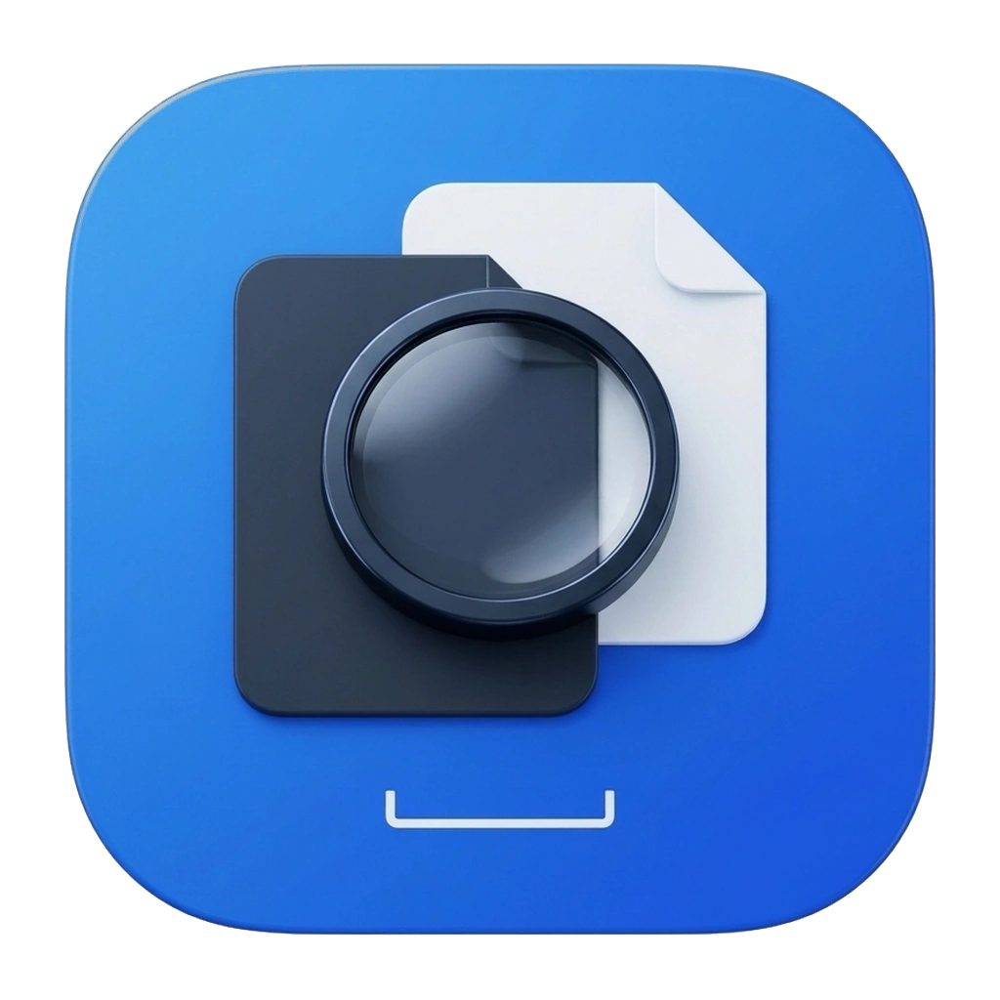
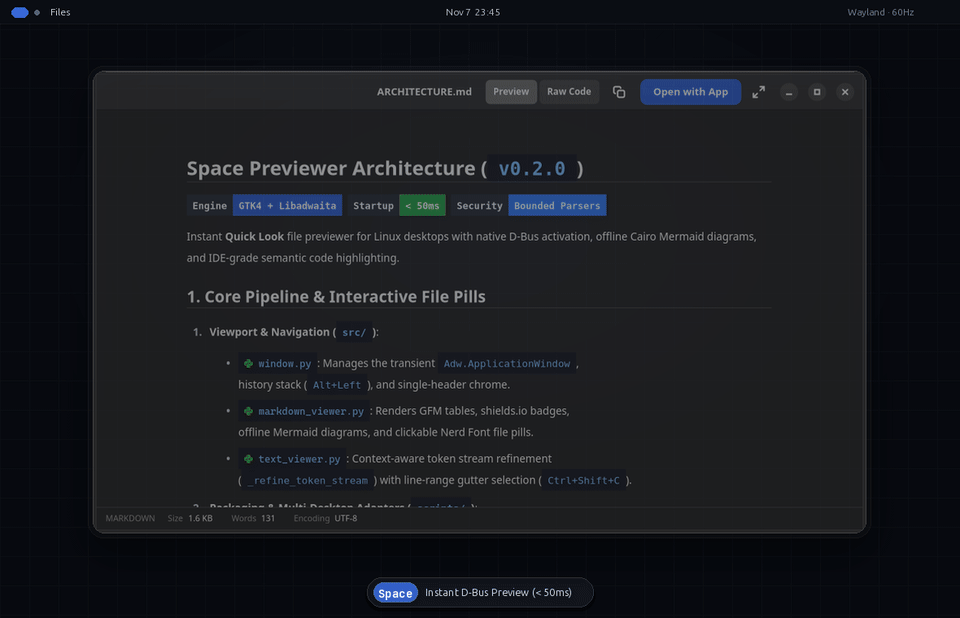

<div align="center">



# Space Previewer

**Trình xem nhanh tệp (Quick Look) cho Linux Desktop — tích hợp phím `Space` gốc trên GNOME / Nautilus, menu ngữ cảnh KDE Dolphin, Cinnamon Nemo và CLI độc lập, phát triển trên GTK4 + Libadwaita.**

[](LICENSE)
[](#moi-truong-ho-tro)
[](#tinh-nang)
[](VERSION)

[**English**](README.md) · [**Tiếng Việt**](README.vi.md) · [**Website & Interactive Showcase**](https://todo-laterx.github.io/space-previewer/?lang=vi) · [**Bản phát hành (Releases)**](https://github.com/todo-laterx/space-previewer/releases)

<br />



</div>

---

## Vì sao chọn Space Previewer

| Khả năng | Trình xem mặc định / Khác | Space Previewer |
|---|---|---|
| **Markdown (`.md`, `.mdx`)** | Chỉ hiển thị văn bản thuần (raw text) | Hiển thị GFM đầy đủ (bảng, danh sách công việc, callouts, huy hiệu shields.io), vẽ sơ đồ Mermaid ngoại tuyến bằng Cairo, pill đường dẫn kèm icon ngôn ngữ Nerd Font, chuyển đổi nhanh Raw/Preview |
| **Click mở tệp liên kết & Nhớ vị trí cuộn** | Không hỗ trợ | Bấm trực tiếp vào pill đường dẫn tệp nội bộ hoặc `[file.rs](...#L10-L30)` trong Markdown để xem tệp đích tại đúng dòng code, bấm `Alt+Left` (Quay lại) để trở về đúng vị trí cuộn ban đầu |
| **Tìm kiếm trong tệp (`Ctrl+F`)** | Không hỗ trợ | Thanh tìm kiếm nổi không chiếm quyền điều hướng trong mã nguồn, văn bản thuần và cả bản dựng Markdown (`Enter` / `Shift+Enter`) |
| **Sao chép dòng & trích dẫn khối** | Không hỗ trợ | Kéo cột số dòng trong mã nguồn hoặc bấm chọn khối Markdown (`Shift+Click` chọn dải, `Ctrl+Click` chọn các khối/mục rời rạc) để chép nội dung hoặc tham chiếu `path:start-end` |
| **Tô màu cú pháp ngữ nghĩa chuẩn IDE** | Tô màu từ khoá cơ bản | Phân tích luồng token theo ngữ cảnh (lời gọi hàm, khai báo, kiểu PascalCase, hằng số, thuộc tính `.prop`, nội suy `${...}` trong JS, cờ/biến Bash, docstring) |
| **CSV / TSV** | Văn bản thuần | Bảng dữ liệu có tiêu đề cột và cuộn mượt |
| **Tệp nén (`.zip`, `.tar.*`)** | Chỉ hiện dung lượng tổng | Hiển thị cây thư mục và kích thước từng mục mà không cần giải nén ra đĩa |
| **Tài liệu Office (`.docx`, `.xlsx`, `.pptx`)** | Yêu cầu cài đặt bộ ứng dụng văn phòng nặng | Đọc trực tiếp cấu trúc ZIP/XML không phụ thuộc ngoài, có giới hạn an toàn chống quá tải |
| **Thư mục (Folders)** | Chỉ đếm số mục | Thống kê số tệp/thư mục con, xem trước danh sách mục đầu và tính tổng dung lượng bất đồng bộ ở nền |
| **Tài liệu PDF** | Xem từng trang rời rạc | Cuộn liên tục vừa chiều ngang (fit-width) với kết xuất trang lười (lazy rasterisation) và chuyển trang mượt bằng `PageUp`/`PageDown` |

---

## Tính năng nổi bật

- **Xem nhanh tức thì với phím `Space`**: Nhấn `Space` trên bất kỳ tệp hoặc thư mục nào trong Nautilus để xem ngay nội dung dưới 50 ms.
- **Tự động cập nhật khi di chuyển**: Giữ cửa sổ xem trước mở và dùng các phím mũi tên `Up` `Down` `Left` `Right` trong trình quản lý tệp để duyệt liên tục.
- **Gắn kết mượt với cửa sổ Files**: Hoạt động như cửa sổ con (transient child) trên cả Wayland và X11, gom nhóm gọn gàng dưới biểu tượng Files trên thanh Dock.
- **Bấm xem tệp liên kết & Nhớ vị trí cuộn**: Các đường dẫn mã nguồn trong Markdown được hiển thị dạng pill tối màu kèm biểu tượng ngôn ngữ vector (`.rs`, `.py`, `.js`, `.ts`, `.sh`, `.c`, `.md`, `.json`, `.toml`, `.yaml`). Bấm vào liên kết để nhảy thẳng sang tệp đó (tô sáng dải dòng `#Lstart-Lend`) và bấm `Alt+Left` để quay về đúng vị trí đang đọc.
- **Sao chép dải dòng & khối linh hoạt**: Kéo chọn số dòng trong trình xem code, hoặc bấm chọn các khối/mục danh sách trong Markdown (`Shift+Click` chọn liên tiếp, `Ctrl+Click` chọn rời rạc từng câu/mục theo cấp độ thụt lề, `Escape` hoặc bấm ra ngoài để xoá chọn). Sao chép văn bản hoặc sao chép trích dẫn `path:start-end` (`Ctrl+Shift+C`).
- **Giao diện đồng nhất**: Duy nhất một thanh `Adw.HeaderBar` và một thanh trạng thái dưới cùng cho mọi định dạng.
- **Đa ngôn ngữ**: Hỗ trợ đầy đủ Tiếng Anh và Tiếng Việt (`SPACE_PREVIEWER_LANG=vi`).

---

## Môi trường hỗ trợ

| Bản phân phối | Môi trường / Trình quản lý tệp | Đóng gói | Ghi chú |
|---|---|---|---|
| **Ubuntu 22.04 / 24.04 / 26.04+ / Linux Mint** | GNOME (Nautilus), KDE Plasma (Dolphin) & Cinnamon (Nemo) | `.deb` / `AppImage` / `./install.sh` | Tương thích hoàn toàn giao thức D-Bus `NautilusPreviewer2`, dùng `dpkg-divert` chung sống sạch sẽ với dịch vụ xem trước mặc định, kèm menu chuột phải cho Dolphin & Nemo |
| **Debian 12 / 13** | GNOME (Nautilus), KDE Plasma (Dolphin) & Cinnamon (Nemo) | `.deb` / `AppImage` / `./install.sh` | Hỗ trợ `dpkg-divert` an toàn và tự động khôi phục khi gỡ cài đặt |
| **Fedora 40+** | GNOME (Nautilus), KDE Spin (Dolphin) & Cinnamon (Nemo) | `.rpm` / `AppImage` / `./install.sh` | Gói `.noarch.rpm` tích hợp dịch vụ D-Bus Nautilus, Dolphin service menu và Nemo action |
| **Arch Linux / Manjaro / EndeavourOS** | GNOME (Nautilus), KDE Plasma (Dolphin) & Cinnamon (Nemo) | `PKGBUILD` / `AppImage` / `./install.sh` | Đóng gói chuẩn Arch qua `packaging/PKGBUILD` (`makepkg -si`) hoặc cài đặt mức người dùng |
| **openSUSE Tumbleweed / Leap** | GNOME (Nautilus), KDE Plasma (Dolphin) & Cinnamon (Nemo) | `AppImage` / `./install.sh` | Tự động kiểm tra gói phụ thuộc GTK4 + Libadwaita qua `zypper` (`./install.sh --check-deps`) |

---

## Cài đặt nhanh

### 1. Gói Debian / Ubuntu / Linux Mint (`.deb`)

```bash
sudo apt install ./dist/space-previewer_0.2.0_amd64.deb
```

### 2. Gói Fedora / RHEL (`.rpm`)

```bash
sudo dnf install --allowerasing ./dist/space-previewer-0.2.0-1.noarch.rpm
```

### 3. Arch Linux / Manjaro (`PKGBUILD`)

```bash
cd packaging
makepkg -si
```

### 4. Bản `AppImage` di động (`x86_64`)

```bash
chmod +x ./dist/Space-Previewer-0.2.0-x86_64.AppImage
./dist/Space-Previewer-0.2.0-x86_64.AppImage --install
```

### 5. Cài đặt từ mã nguồn cho người dùng hiện tại (Không cần quyền root)

```bash
./install.sh --check-deps
./install.sh
```

Để gỡ cài đặt:

```bash
./uninstall.sh
```

---

## Phím tắt

- **`Space`** hoặc **`Escape`**: Đóng cửa sổ xem trước (hoặc đóng thanh tìm kiếm / huỷ chọn dòng nếu đang mở).
- **`Alt + Left`** (hoặc nút **Back**): Quay lại tệp trước đó tại đúng vị trí cuộn.
- **`Ctrl + F`**: Mở thanh tìm kiếm nhanh trong tệp.
- **`Ctrl + Shift + C`**: Sao chép vùng đang chọn dưới dạng trích dẫn `path:start-end`.
- **Kéo cột số dòng** (Code/Text): Chọn dải dòng và hiện thẻ sao chép.
- **Click / `Shift + Click` / `Ctrl + Click`** (Markdown): Chọn một khối, một dải khối hoặc các mục rời rạc để sao chép.
- **`F`** hoặc **`F11`**: Toàn màn hình.
- **`O`**: Mở tệp bằng ứng dụng mặc định của hệ thống.
- **`Up` / `Down` / `Left` / `Right`** *(Nautilus)*: Di chuyển tệp đang chọn trong Files; cửa sổ xem trước tự động cập nhật theo.

---

## Giấy phép & Nhãn hiệu

- Mã nguồn được phát hành theo giấy phép [GNU General Public License v3.0](LICENSE).
- Quy định sử dụng thương hiệu và biểu trưng xem tại [TRADEMARK.md](TRADEMARK.md).
